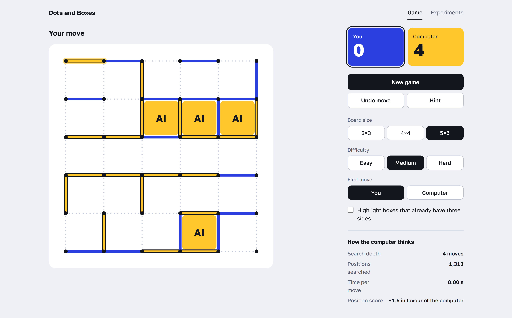
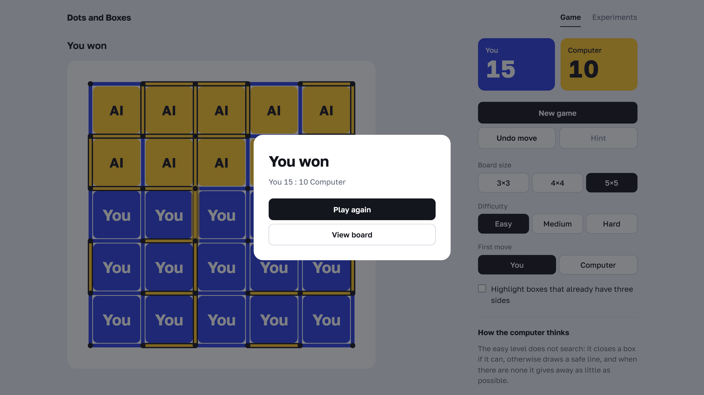
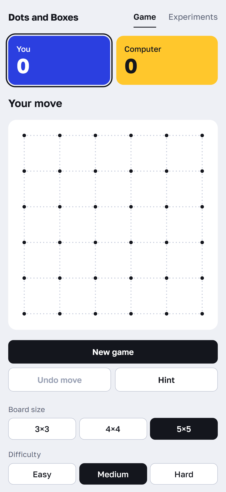

<h1 align="center">Dots and Boxes</h1>

<p align="center">
  Play Dots and Boxes against a computer with three difficulty levels, from a simple rule-based opponent to an alpha-beta search with exact endgame solving.
</p>

<p align="center">
  
</p>

## Features

- 3×3, 4×4 and 5×5 boards, choose who moves first.
- Three levels: easy (greedy rules), medium (alpha-beta, depth 4), hard (iterative deepening, transposition table, chain analysis, exact endgame).
- Undo move, hints from the hard engine and optional highlighting of boxes with three sides.
- An **Experiments** page runs AI-versus-AI matches, time and node measurements, game-stage timings and an algorithm ablation in the browser, with a progress bar and Markdown / CSV export. The same experiments are available from the terminal with `npm run bench`.
- The computer thinks in a Web Worker, so the interface never freezes.
- Keyboard control and a responsive layout down to mobile.

<table>
  <tr>
    <td align="center">
      
    </td>
    <td align="center">
      
    </td>
  </tr>
</table>

## Stack

- **App:** React 18, TypeScript, Vite, plain CSS, Web Workers
- **Tests:** Vitest
- **Engine and AI:** pure TypeScript, no libraries (`src/engine` for the rules, `src/ai` for the three opponents)

## Quick start

Requires Node.js 20+.

```bash
npm install
npm run dev
```

The app runs at `http://localhost:5173`.

```bash
npm test          # unit tests
npm run build     # type check and production build
npm run bench     # AI benchmark, prints tables and writes them to docs/
```
